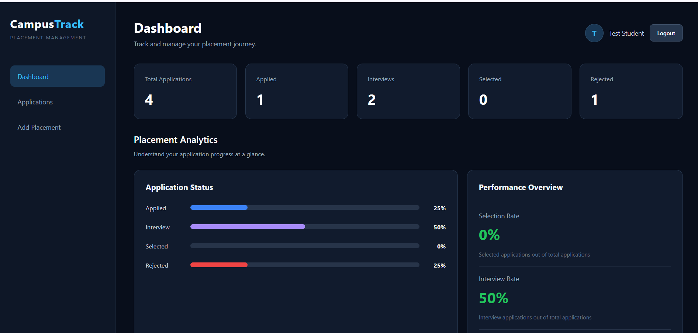

# Campus Placement Tracker

A full-stack web application built using Java, Spring Boot, MySQL, HTML, CSS and JavaScript to help students manage and track their job and internship applications.

## Overview

Campus Placement Tracker allows students to maintain their placement application records in one place. Each student can create an account, log in securely and manage their own applications.

## Application Preview



## Features

- Student registration and login
- Secure password hashing using BCrypt
- Session-based authentication
- Add new placement applications
- View all placement records
- Search applications by company name
- Update application details and status
- Delete placement records
- Duplicate application prevention
- Input validation and error handling
- Student-specific data isolation
- Dashboard with placement statistics

## Technologies Used

**Backend**
- Java
- Spring Boot
- Spring Data JPA
- Hibernate
- Maven

**Frontend**
- HTML
- CSS
- JavaScript

**Database**
- MySQL

**Security**
- BCrypt password hashing
- HTTP session-based authentication
- Student-level data access control

## Database

The application uses MySQL to store student accounts and placement application records.

Main tables:
- `students` – stores student account information.
- `placements` – stores placement application details linked to individual students.

## Project Structure

```text
campus-placement-tracker/
├── src/
│   └── main/
│       ├── java/
│       │   └── CampusPlacementTracker/
│       │       ├── config/
│       │       ├── controller/
│       │       ├── dto/
│       │       ├── entity/
│       │       ├── exception/
│       │       ├── repository/
│       │       └── service/
│       └── resources/
│           ├── static/
│           │   ├── index.html
│           │   ├── style.css
│           │   └── script.js
│           └── application.properties
├── mvnw
├── mvnw.cmd
├── pom.xml
└── README.md
```

## How to Run the Project

### Prerequisites
- Java 17 or later
- MySQL Server 8.0 or later
- Git

### 1. Clone the repository

```bash
git clone YOUR_GITHUB_REPOSITORY_URL
cd campus-placement-tracker
```

### 2. Create the database

Open MySQL and execute:

```sql
CREATE DATABASE campus_placement;
```

### 3. Configure database credentials

Update `src/main/resources/application.properties`:

```properties
spring.datasource.url=jdbc:mysql://localhost:3306/campus_placement
spring.datasource.username=root
spring.datasource.password=YOUR_LOCAL_PASSWORD

spring.jpa.hibernate.ddl-auto=update
spring.jpa.show-sql=true
spring.jpa.open-in-view=false
```

Replace the password with your local MySQL password.

### 4. Run the application

On Windows PowerShell:

```powershell
.\mvnw.cmd spring-boot:run
```

### 5. Open the application

Visit:

http://localhost:8080

Register an account and start tracking placement applications!

## Security

- Passwords are stored as BCrypt hashes.
- Login sessions protect placement management endpoints.
- Students can access only their own placement records.
- Duplicate applications are prevented.
- Server-side validation protects incoming data.

## Future Improvements

- Resume upload functionality
- Email notifications for interview updates
- Placement analytics and visual reports
- Admin dashboard
- Cloud deployment

## Author

Developed as a full-stack Java web development project.</